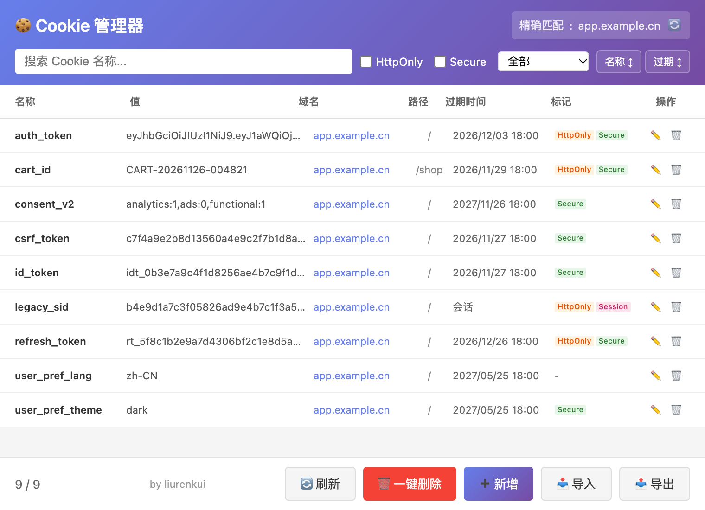
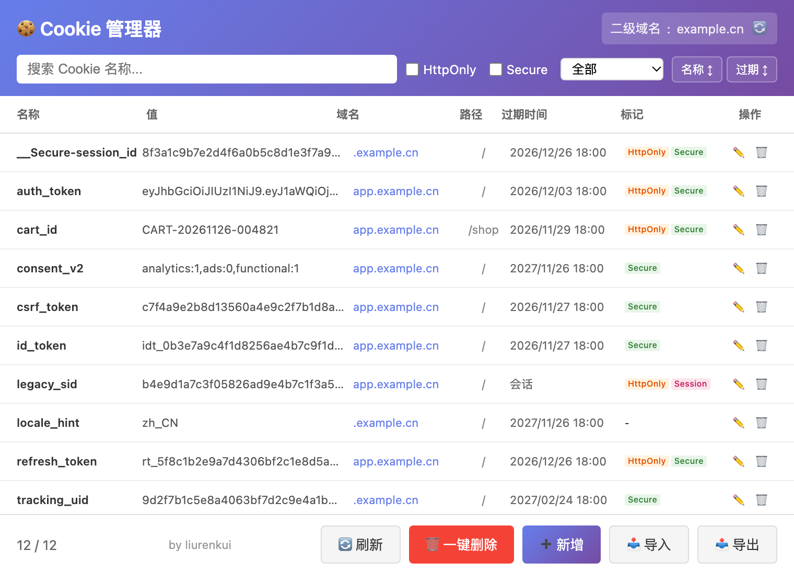
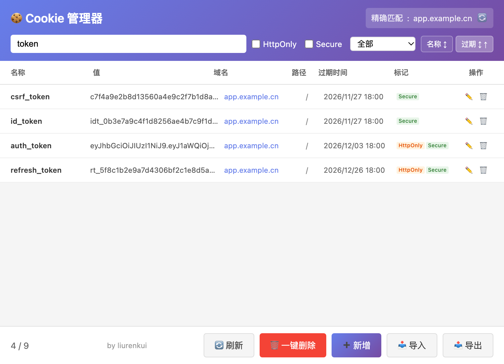
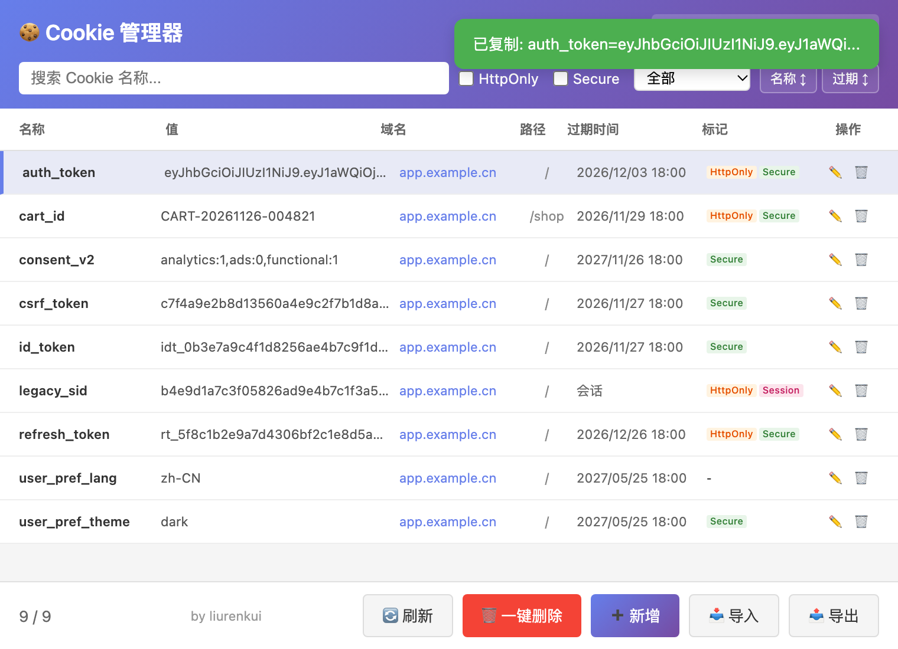
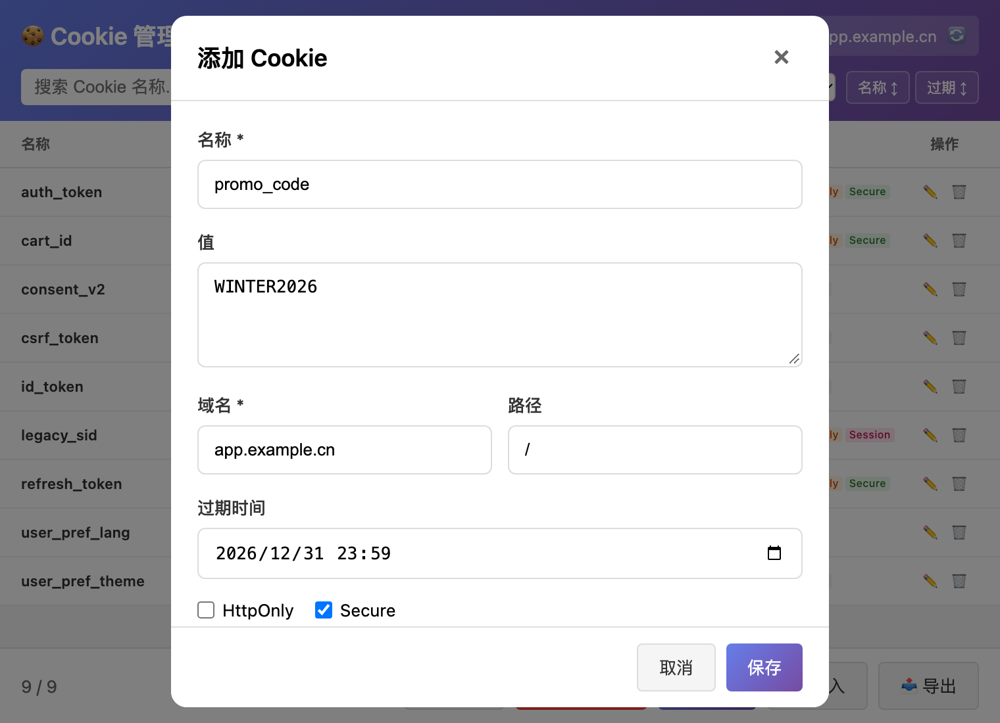
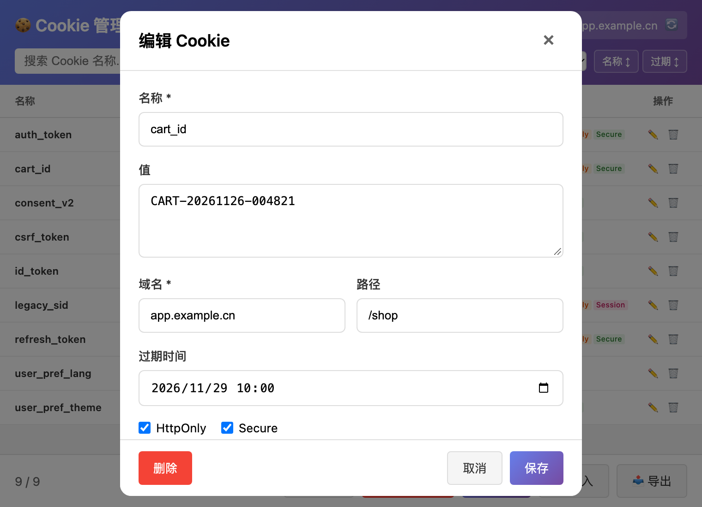
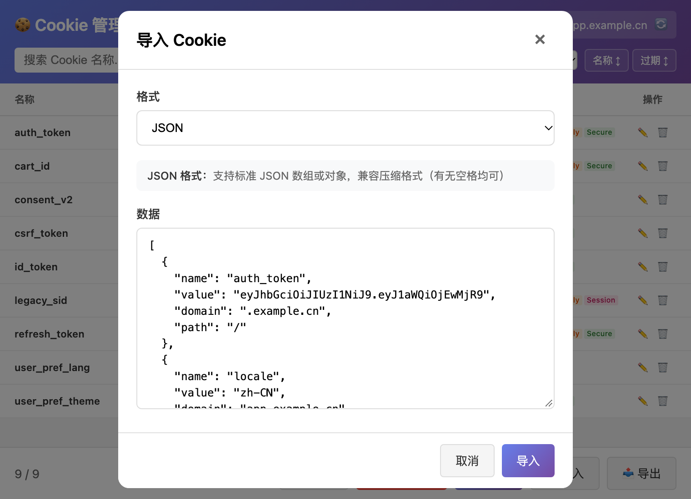
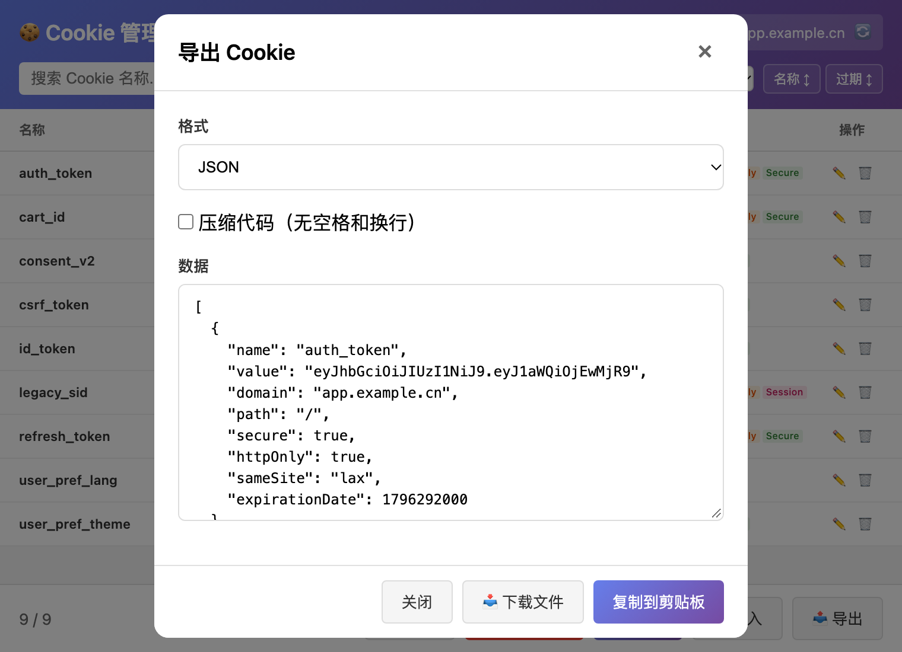

<p align="center">
  
</p>

<h1 align="center">🍪 Cookie 管理器</h1>

<p align="center">
  一个用于 Chrome / Edge 的 Cookie 管理扩展：查看、搜索、过滤、排序、新增、编辑、删除，<br>
  支持 JSON / Header String / Netscape 三种格式的导入与导出。
</p>

<p align="center">
  Chrome Extension · Manifest V3 · Chrome / Edge 88+ · MIT License
</p>

---

## 界面总览

点击浏览器工具栏中的 🍪 图标即可打开。顶部是域名与筛选区，中间是可滚动的 Cookie 列表，底部是统计信息与操作按钮。



---

## 功能特性

### 1. 域名匹配：精确域名 / 二级域名

右上角的域名徽标显示当前查询范围，点击 `🔄` 按钮可在两种模式间切换：

| 模式 | 查询范围 | 典型用途 |
| --- | --- | --- |
| 精确匹配 | 当前页面主机名（如 `app.example.cn`） | 只关心当前站点自身的 Cookie |
| 二级域名 | 取主机名最后两段（如 `example.cn`） | 一次性查看主域及其子域的全部 Cookie |

下图是切换到「二级域名」后的效果：列表同时包含 `app.example.cn` 与 `.example.cn` 的 Cookie，总数由 9 变为 12。



### 2. 搜索、过滤与排序

- **关键字搜索**：按 Cookie 名称模糊匹配，输入即筛（300ms 防抖），清空后恢复全部。
- **HttpOnly / Secure 过滤**：勾选后只保留带对应标记的 Cookie，可叠加使用。
- **会话过滤**：下拉框支持「全部 / 显示 session / 排除 session」。
- **排序**：点击「名称」「过期」按钮排序，再次点击切换升序 / 降序（按钮上的箭头表示当前方向）。
- **实时统计**：底部左侧显示 `过滤后数量 / 总数`，与列表保持同步。

下图输入关键字 `token`，从 9 条中筛出 4 条，并按过期时间升序排列：



### 3. 一键复制 Cookie

点击任意一行，即可把该 Cookie 以 `name=value` 的 Header String 形式复制到剪贴板，行同时高亮并弹出 Toast 提示，方便直接粘贴到 `curl`、Postman 或代码中。



### 4. 新增 Cookie

点击底部 `➕ 新增` 打开表单：

- 域名默认填入当前查询域名，路径默认 `/`，减少重复输入；
- 支持设置值、过期时间（留空即为会话 Cookie）、HttpOnly、Secure；
- 名称为必填项，保存失败会在 Toast 中给出具体原因。



### 5. 编辑与删除

每行右侧提供 `✏️ 编辑` 与 `🗑️ 删除` 两个操作：

- 编辑会回填全部字段，弹窗左下角额外提供「删除」按钮；
- 保存时采用「先删除旧 Cookie，再写入新 Cookie」的方式，因此修改名称、域名或路径相当于把 Cookie 迁移到新位置；
- 单条删除会二次确认，避免误操作。



### 6. 导入 Cookie

点击底部 `📥 导入`，选择格式后粘贴数据即可，导入前会弹出确认框，并逐条统计成功 / 失败数量。

| 格式 | 说明 | 示例 |
| --- | --- | --- |
| JSON | 标准 JSON 数组、`{"cookies": [...]}` 或单个对象，压缩 / 格式化均可 | `[{"name":"token","value":"abc","domain":".example.cn","path":"/"}]` |
| Header String | 分号分隔或每行一个 | `a=1; b=2` 或 `a=1\nb=2` |
| Netscape | 制表符分隔的标准 Cookie 文件 | `# Netscape HTTP Cookie File` + 7 列记录 |



### 7. 导出 Cookie

点击底部 `📤 导出`，导出内容基于**当前筛选结果**（无筛选结果时回退为全部），并提供两种落地方式：

- **复制到剪贴板**：适合快速粘贴；
- **下载文件**：按 `域名_时间戳.扩展名` 命名，如 `app.example.cn_2026-11-26-18-30-00.json`。

格式选项：

- **JSON**：可选「压缩代码」输出单行紧凑 JSON；
- **Header String**：可选「每个 Cookie 单独一行」，否则以 `; ` 连接；
- **Netscape**：自动生成首行注释、域名是否含子域、过期时间戳等 7 个字段。



### 8. 列表细节

- **列宽拖拽**：拖拽表头分隔线可调整列宽（最小 30px），值较长时自动省略号显示，悬停可看完整内容；
- **刷新**：`🔄 刷新` 重新读取当前域名下的 Cookie；
- **一键删除**：`🗑️ 一键删除` 会删除当前列表中的全部 Cookie，执行前弹出数量确认，属于不可逆操作；
- **空状态**：无匹配结果时展示占位提示，而不是空白列表；
- **Toast 反馈**：复制、保存、删除、导入导出等操作均有成功 / 警告 / 错误提示。

---

## 安装方法

### 方法一：开发者模式加载（推荐）

1. 打开 Chrome，访问 `chrome://extensions/`
2. 开启右上角的「开发者模式」
3. 点击「加载已解压的扩展程序」
4. 选择本扩展所在文件夹（包含 `manifest.json` 的目录）
5. 扩展图标出现在工具栏，点击即可使用

> 修改代码后，在 `chrome://extensions/` 页面点击该扩展卡片的刷新按钮重新加载。

### 方法二：打包安装

1. 在 `chrome://extensions/` 点击「打包扩展程序」
2. 选择扩展文件夹，生成 `.crx` 与 `.pem`
3. 将 `.crx` 拖入 Chrome 安装

---

## 使用方法

| 操作 | 步骤 |
| --- | --- |
| 查看 Cookie | 打开扩展，自动加载当前标签页域名下的 Cookie |
| 复制单条 | 点击列表中的任意一行 |
| 新增 | `➕ 新增` → 填写名称、值、域名等 → 保存 |
| 编辑 | 行尾 `✏️` → 修改字段 → 保存 |
| 删除单条 | 行尾 `🗑️` → 确认 |
| 批量删除 | `🗑️ 一键删除` → 确认（删除当前列表内容） |
| 导入 | `📥 导入` → 选择格式 → 粘贴数据 → 导入 → 确认 |
| 导出 | `📤 导出` → 选择格式与选项 → 复制或下载 |

---

## 目录结构

```
cookie-identify-manager/
├── manifest.json              # 扩展配置（Manifest V3）
├── popup.html                 # 弹出窗口结构
├── popup.css                  # 样式（布局、模态框、列表）
├── popup-main.js              # 全部逻辑：状态、查询、渲染、导入导出
├── icons/
│   ├── icon.svg               # 图标源文件
│   ├── icon16.png
│   ├── icon48.png
│   ├── icon64.png
│   └── icon128.png
├── docs/
│   └── screenshots/           # README 截图（2x PNG，演示数据为虚构）
└── README.md
```

---

## 技术实现

### 状态管理

`popup-main.js` 使用单一状态对象驱动渲染，筛选、排序、导出共用同一份数据：

```javascript
const state = {
  cookies: [],            // 原始查询结果
  filteredCookies: [],    // 过滤 + 排序后的结果
  currentDomain: '',      // 当前页面主机名
  baseDomain: '',         // 二级域名（主机名最后两段）
  domainMode: 'exact',    // exact | base
  searchKeyword: '',
  filters: { httpOnly: false, secure: false, session: 'all' },
  sort: { field: 'name', order: 'asc' },
  exportFormat: 'json',
  headerLineBreak: false,
  jsonCompress: false
};
```

数据流：`chrome.cookies.getAll()` → `applyFiltersAndSort()` → `renderCookieList()` + `updateStats()`。
新增、编辑、删除、导入完成后都会重新拉取列表，保证界面与浏览器真实状态一致。

### Cookie API 关键细节

- **查询**：`chrome.cookies.getAll({ domain })`，`domain` 匹配该域名及其子域；
- **删除**：`chrome.cookies.remove({ url, name })`，只需 URL 与名称，不传 `domain` / `path`；
- **构建 URL**：按 `http(s)://` + 去前导点的域名 + path 组装，`secure` 标记决定协议；
- **编辑**：先 `remove` 旧 Cookie，再 `set` 新 Cookie；
- **会话 Cookie**：不传 `expirationDate` 即写入会话级 Cookie。

### 界面结构

- Flex 纵向布局：头部与底部固定，列表区域独立滚动；
- 列表表头与数据行使用相同的列宽类，拖拽时同步更新；
- 模态框采用「固定头尾 + 内容区滚动」的结构，保证 550px 高的弹窗内表单与按钮始终可见。

---

## 权限说明

| 权限 | 用途 |
| --- | --- |
| `cookies` | 读取、创建、修改、删除 Cookie |
| `activeTab` | 获取当前标签页 URL，推断查询域名 |
| `clipboardWrite` | 复制 Cookie 值、导出内容 |
| `storage` | 预留用于保存用户偏好 |
| `<all_urls>` | 允许对任意站点执行 Cookie 操作 |

---

## 兼容性

- Chrome 88+（Manifest V3）
- Edge 88+ 及其他 Chromium 内核浏览器

---

## 注意事项

1. **二级域名推断**取主机名最后两段，未接入公共后缀列表，对 `example.co.uk` 这类域名会得到 `co.uk`，此时可切换回精确匹配；
2. **编辑即重建**：保存时会先删除原 Cookie 再写入，`SameSite` 等未在表单中暴露的属性不会保留；
3. **第三方 Cookie**：受浏览器隐私设置与分区策略影响，部分 Cookie 可能无法读取或写入；
4. **一键删除不可逆**：作用于当前列表，请在确认框中核对数量后再执行；
5. **README 截图**使用本机渲染的演示数据（`app.example.cn`），不对应任何真实站点。

---

## 许可证

MIT License © liurenkui (1056856191@qq.com)
